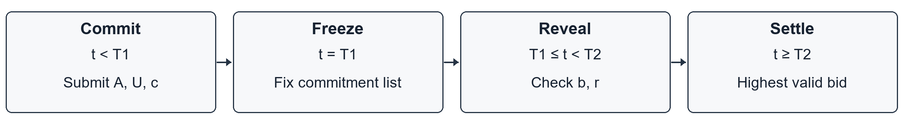

# 4. Protocol Description

Our model, M1, is a first-price sealed-bid auction for one item. Before bidding starts, the organizer announces the auction ID `A`, eligible bidder IDs `U`, price rules, deadlines `T1 < T2`, and tie rule. Each bidder chooses an integer bid `b` and generates a fresh secret 128-bit value `r` using a cryptographic random generator. The commitment is

`c = SHA-256(Encode("CR-AUCTION-v1", A, U, "VND", b, r))`.

Encode stores these six fields in this order, each with a four-byte big-endian length prefix. The bid uses eight unsigned big-endian bytes, and `r` uses 16 raw bytes. This keeps field boundaries clear.

Before `T1`, a bidder sends `A,U,c`. The organizer accepts one commitment per bidder and rejects later submissions from that bidder. It records the receipt time and returns an unsigned receipt. At `T1`, it freezes the accepted list. During `T1 ≤ t < T2`, bidders reveal `b,r`. The organizer checks the auction, sender, price and hash against the stored commitment. Bidders without a valid reveal by `T2` are excluded.

At or after `T2`, the highest valid bid wins and pays its own amount. Ties go to the smallest preassigned bidder ID in lexicographic order. If no valid reveal exists, there is no winner. Our example allows VND 10,000–1,000,000 in steps of VND 10,000. With three valid reveals of VND 100,000, 130,000 and 120,000, the VND 130,000 bidder wins. The example uses 10:00 and 10:10 Vietnam time as hypothetical deadlines. Identity and time are simulated inputs, and the model assumes the frozen list is kept unchanged.

*Figure 1. Commit, freeze, reveal and settlement in M1.*
