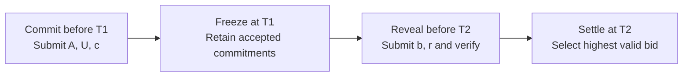

# Protocol Description

M1 is a first-price sealed-bid auction for one item. Before bidding, the organizer publishes the auction identifier `A`, eligible bidder identifiers `U`, permitted prices in VND, deadlines `T1 < T2`, and the tie-breaking rule. Each bidder selects an integer bid `b` and generates a fresh secret 128-bit value `r` with a cryptographic random generator. The commitment is

`c = SHA-256(Encode("CR-AUCTION-v1", A, U, "VND", b, r))`.

Before `T1`, each eligible bidder sends `A,U,c`. The organizer accepts one commitment per bidder, records when it was received, and returns a receipt. At `T1`, the organizer freezes the accepted list. During `T1 ≤ t < T2`, each bidder may reveal `b,r`. The organizer checks the session, sender, price and hash against the recorded commitment. At `T2`, the highest valid revealed bid wins and pays its own bid. Ties go to the lexicographically smallest preassigned bidder ID. If there are no valid reveals, there is no winner.

In the example, `T1` is 10:00 and `T2` is 10:10 on a hypothetical day in Vietnam. If three bids of VND 100,000, 130,000, and 120,000 are all validly revealed, the bidder who offered VND 130,000 wins and pays that amount. The simulation models sender identity and time and assumes the frozen list is preserved.

*Figure. M1 auction phases. The reveal window includes T1 and excludes T2.*
